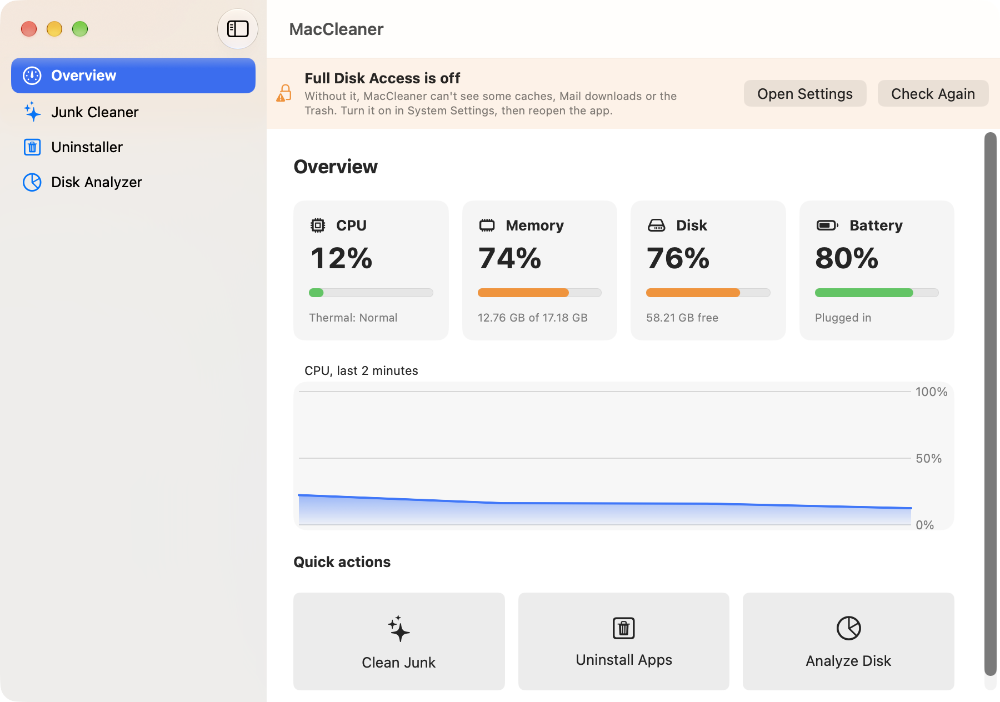
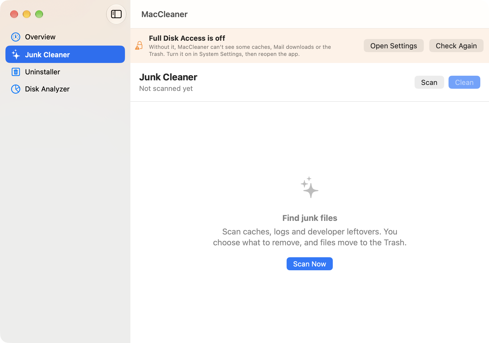
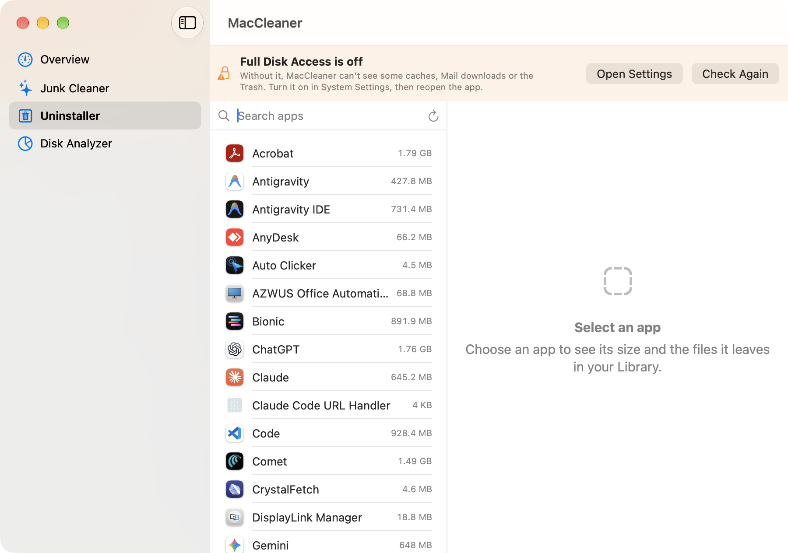
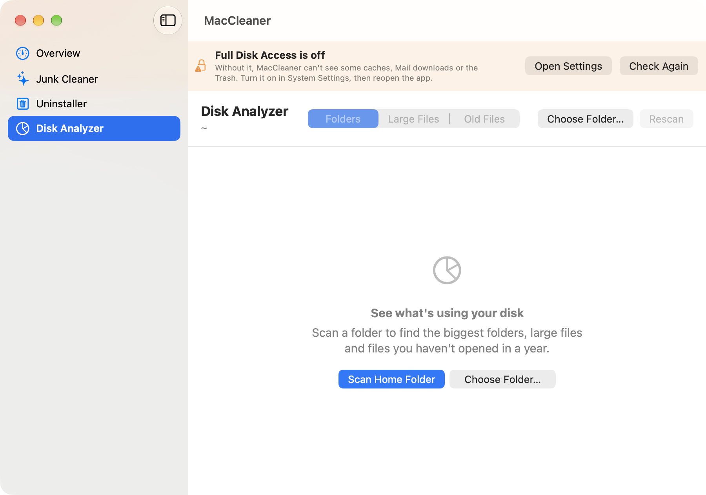

# MacCleaner

A free, open-source CleanMyMac alternative for Apple Silicon Macs. It's a native SwiftUI app with no telemetry and no accounts. It makes no network requests unless you choose a cloud AI provider in Settings.

| Feature | What it does |
|---|---|
| **Junk Cleaner** | Finds user caches, logs, Xcode DerivedData and device support files, Homebrew, npm/pip/Yarn/CocoaPods/Gradle caches, browser caches, Mail downloads and the Trash. You preview every file before removing it. |
| **Uninstaller** | Removes an app together with its leftovers in `~/Library` (Application Support, Caches, Preferences, Containers, Group Containers, Saved State, LaunchAgents and more). Sort the app list by name, size, last used or date added to spot apps you never open. |
| **Disk Analyzer** | Drill down through folder sizes with a donut chart, plus: a **Breakdown** by file type, age and top folder; **Largest** files with filters (type, size, age, name, location) and a **Space Hogs** list of the folders that really hold the space; **Old Files**; **Duplicates** (content-compared with SHA-256, extra copies go to the Trash); **History** of disk usage over time with folder-by-folder comparison; and **Move to external drive, NAS or iCloud Drive** (copy → verify → original to Trash). |
| **AI Disk Advisor** | Explains any file or folder and reviews a whole scan: what it is, whether it's safe to delete, how to stop it growing and how to clean it up. Runs on-device by default; see [AI Disk Advisor](#ai-disk-advisor). |
| **Settings** | A sidebar page (also ⌘,) with General (menu-bar monitor, Full Disk Access, reset), Disk Analyzer (default folder, space-hog / old-file / duplicate thresholds, usage history), Uninstaller (default sort, Apple apps) and AI (provider, endpoint, model, key, privacy) settings. |
| **System Monitor** | A menu-bar popover and dashboard showing CPU (with history), memory, disk, battery and thermal state. Thermal state matters on the fanless M4 MacBook Air. |

## Screenshots

| Overview | Junk Cleaner |
|---|---|
|  |  |
| **Uninstaller** | **Disk Analyzer** |
|  |  |

## AI Disk Advisor
Most cleaners give you a list of big files. MacCleaner also tells you what they are and what to do about them.

- **Explain with AI.** Right-click any file or folder in the Disk Analyzer (or click ✨ on a space hog). The inspector shows:
  - the file type and what it is (for example "Xcode build cache" or "iPhone backup");
  - a safety rating: **Safe to delete**, **Review first** or **Keep**, with the reason;
  - how to stop it growing back;
  - step-by-step cleanup;
  - whether to **move it** to an external drive, NAS or iCloud Drive rather than delete it. Move, Trash and Reveal buttons sit right there.
- **Analyze Results.** One click turns a whole scan (space hogs, file-type breakdown, history trend, duplicates) into a short report: a headline, ranked findings that link to the item, and habits that keep the disk tidy.
- **The rules always win on safety.** A built-in expert rule set covers Xcode DerivedData, Archives and simulators, iPhone backups, Docker, `node_modules`, package caches, Homebrew, Mail, Photos, Messages, installers, VMs and more. The final rating is the *more cautious* of the AI and the rules, and anything `SafetyGuard` protects is always **Keep**. A model can never talk you into deleting something the app considers unsafe.
- **Private by default.** The default engine is Apple's on-device model (macOS 26+ with Apple Intelligence), so nothing leaves the Mac. Without it, the built-in rules answer instantly and offline.
- **Bring your own model (optional).** Under **Settings › AI** you can pick:
  - **Azure OpenAI** (endpoint + deployment + API version);
  - **OpenAI**;
  - **Anthropic Claude**;
  - **Google Gemini**;
  - **Ollama**, local or on your network;
  - any **OpenAI-compatible** server (LM Studio, OpenRouter, Groq…).

  **Test Connection** checks the setup. If a provider fails, you still get the rule-based answer, with a note saying why.
- **Metadata only.** Only paths, names, sizes, dates and file kinds are sent, never file contents, and only when you click Explain or Analyze. **Send only the last two folders of each path** trims paths further.

### Where API keys are kept
API keys live only in your **login Keychain** (service `com.maccleaner.ai`). They are never written to UserDefaults, to the repo or to logs, and none are needed to build or run the app. `./scripts/uninstall.sh` deletes them. If you contribute, never commit a key, and blank out your endpoint and deployment names in any screenshot of Settings › AI.

## Safety
- **Files go to the Trash by default.** The only permanent deletion is the "Empty Trash" category, and it is off by default.
- Every deletion passes `SafetyGuard`. Only paths inside your home folder or `/Applications` are allowed. `/System`, `/usr`, `/Library`, `/private`, iCloud Drive, cloud storage, Keychains, Mail, Messages and the Photos library are always blocked. Paths that go through a symlink are rejected.
- Moving files to another disk copies them, verifies the copy (size, file count and SHA-256 for files up to 2 GB), and only then moves the original to the Trash. Sources pass the same `SafetyGuard` checks as deletion.
- AI never deletes anything itself, and its safety rating can never be more permissive than the built-in rules and `SafetyGuard` (see [AI Disk Advisor](#ai-disk-advisor)).
- Apple apps (`com.apple.*`) can't be uninstalled. Leftovers that match only by folder name start unchecked.

## Install
Requirements: an Apple Silicon Mac, macOS 14+ and Xcode 16+ (Xcode 26+ to include on-device AI; older Xcode builds use the built-in rules).

```bash
git clone https://github.com/microsoft-powerbi-dev/mac-cleaner.git && cd mac-cleaner
./scripts/install.sh
```
The script installs XcodeGen with Homebrew if needed, builds a Release copy, installs it to `/Applications/MacCleaner.app` and opens it. Pass `--no-open` to skip launching it. Run the script again to update.

To remove the app, its preferences and its Full Disk Access entry:
```bash
./scripts/uninstall.sh
```

## Build for development
```bash
brew install xcodegen
xcodegen                 # run from the repo root; generates MacCleaner.xcodeproj from project.yml
open MacCleaner.xcodeproj
```
Then press **⌘R** to run or **⌘U** to run the tests.


## Full Disk Access
macOS hides caches, Mail downloads and the Trash from apps until you allow it:
**System Settings → Privacy & Security → Full Disk Access →** turn on **MacCleaner**, then reopen the app.
The app shows a banner with a shortcut while access is off.

Note: builds are ad-hoc signed ("Sign to Run Locally"). macOS may forget the permission after you rebuild. If that happens, remove MacCleaner from the list and add it again.

## Project layout
```
MacCleaner/App          App entry point, main window, menu-bar extra
MacCleaner/Core         SafetyGuard, FileSizer, Trasher, Mover, FileHasher, StorageDestinations, Permissions
MacCleaner/Cleaner      Cleanup catalog, scanner, UI
MacCleaner/Uninstaller  App inventory, leftover finder, UI
MacCleaner/Analyzer     Disk scanner, file kinds, filters/space hogs, duplicates, usage history, advisor (rules + on-device AI), UI
MacCleaner/Analyzer/AI  Remote LLM providers (Azure OpenAI, OpenAI, Anthropic, Gemini, Ollama, OpenAI-compatible)
MacCleaner/Monitor      Mach/IOKit stats, menu-bar and dashboard UI
MacCleanerTests         Safety, leftover-matching, catalog, analyzer, duplicate and mover tests
scripts                 install.sh / uninstall.sh
docs/screenshots        README images
```
To add a cleanup category, add an entry to `CleanupCatalog.all`. The catalog tests check that every new path passes the safety policy.

## Credits
The cleanup-target lists and the preview-before-delete approach come from these MIT-licensed projects:
PureMac, [Mole](https://github.com/tw93/Mole) and Dusty. No code was copied.

## License
MIT
