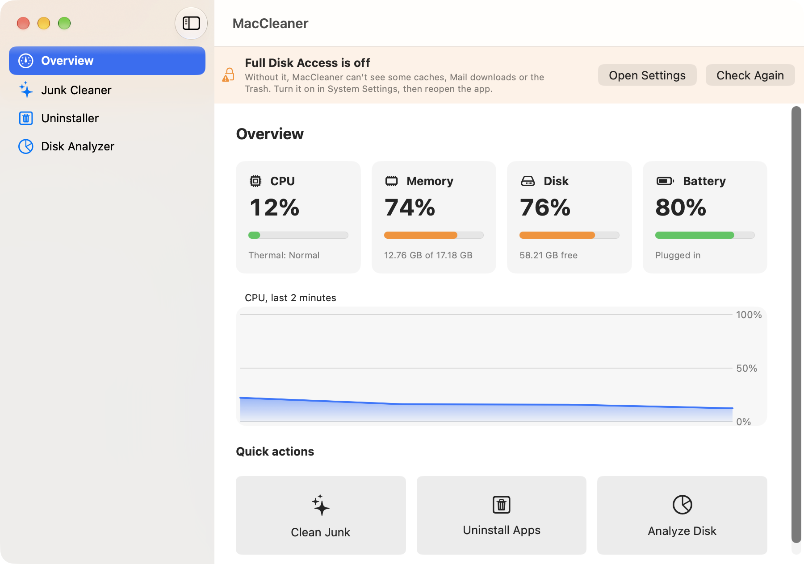
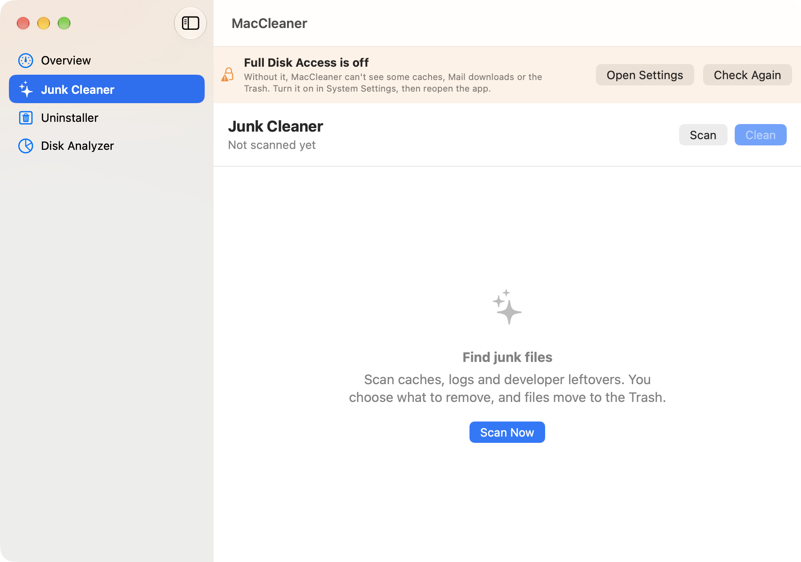
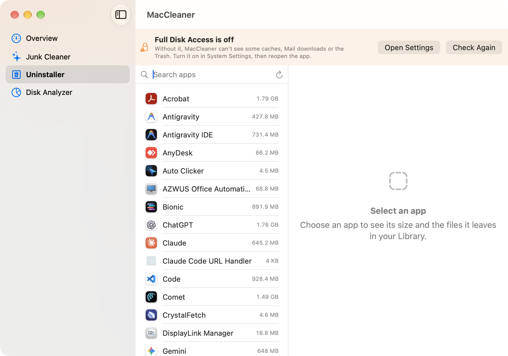
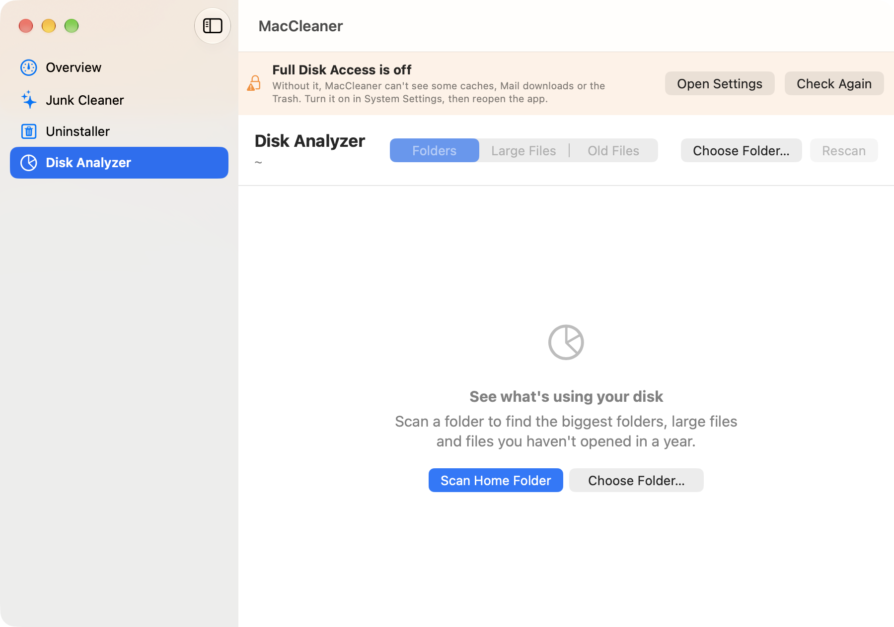

# MacCleaner

A free, open-source CleanMyMac alternative for Apple Silicon Macs. It's a native SwiftUI app with no telemetry, no accounts and no network access.

| Feature | What it does |
|---|---|
| **Junk Cleaner** | Finds user caches, logs, Xcode DerivedData and device support files, Homebrew, npm/pip/Yarn/CocoaPods/Gradle caches, browser caches, Mail downloads and the Trash. You preview every file before removing it. |
| **Uninstaller** | Removes an app together with its leftovers in `~/Library` (Application Support, Caches, Preferences, Containers, Group Containers, Saved State, LaunchAgents and more). |
| **Disk Analyzer** | Lets you drill down through folder sizes and shows a donut chart. Includes "Large Files" (over 100 MB) and "Old Files" (over 10 MB, not opened in a year) lists. |
| **System Monitor** | A menu-bar popover and dashboard showing CPU (with history), memory, disk, battery and thermal state. Thermal state matters on the fanless M4 MacBook Air. |

## Screenshots

| Overview | Junk Cleaner |
|---|---|
|  |  |
| **Uninstaller** | **Disk Analyzer** |
|  |  |

## Safety
- **Files go to the Trash by default.** The only permanent deletion is the "Empty Trash" category, and it is off by default.
- Every deletion passes `SafetyGuard`. Only paths inside your home folder or `/Applications` are allowed. `/System`, `/usr`, `/Library`, `/private`, iCloud Drive, cloud storage, Keychains, Mail, Messages and the Photos library are always blocked. Paths that go through a symlink are rejected.
- Apple apps (`com.apple.*`) can't be uninstalled. Leftovers that match only by folder name start unchecked.

## Install
Requirements: an Apple Silicon Mac, macOS 14+ and Xcode 16+.

```bash
git clone https://github.com/microsoft-powerbi-dev/mac-cleaner.git && cd mac-cleaner
./scripts/install.sh
```
The script installs XcodeGen with Homebrew if needed, builds a Release copy, installs it to `/Applications/MacCleaner.app` and opens it. Pass `--no-open` to skip launching it. Run the script again to update.

To remove the app, its preferences and its Full Disk Access entry:
```bash
./scripts/uninstall.sh
```

## Build for development
```bash
brew install xcodegen
xcodegen                 # run from the repo root; generates MacCleaner.xcodeproj from project.yml
open MacCleaner.xcodeproj
```
Then press **⌘R** to run or **⌘U** to run the tests.


## Full Disk Access
macOS hides caches, Mail downloads and the Trash from apps until you allow it:
**System Settings → Privacy & Security → Full Disk Access →** turn on **MacCleaner**, then reopen the app.
The app shows a banner with a shortcut while access is off.

Note: builds are ad-hoc signed ("Sign to Run Locally"). macOS may forget the permission after you rebuild. If that happens, remove MacCleaner from the list and add it again.

## Project layout
```
MacCleaner/App          App entry point, main window, menu-bar extra
MacCleaner/Core         SafetyGuard, FileSizer, Trasher, Permissions
MacCleaner/Cleaner      Cleanup catalog, scanner, UI
MacCleaner/Uninstaller  App inventory, leftover finder, UI
MacCleaner/Analyzer     Disk tree scanner, UI
MacCleaner/Monitor      Mach/IOKit stats, menu-bar and dashboard UI
MacCleanerTests         Safety, leftover-matching and catalog tests
scripts                 install.sh / uninstall.sh
docs/screenshots        README images
```
To add a cleanup category, add an entry to `CleanupCatalog.all`. The catalog tests check that every new path passes the safety policy.

## Credits
The cleanup-target lists and the preview-before-delete approach come from these MIT-licensed projects:
PureMac, [Mole](https://github.com/tw93/Mole) and Dusty. No code was copied.

## License
MIT
